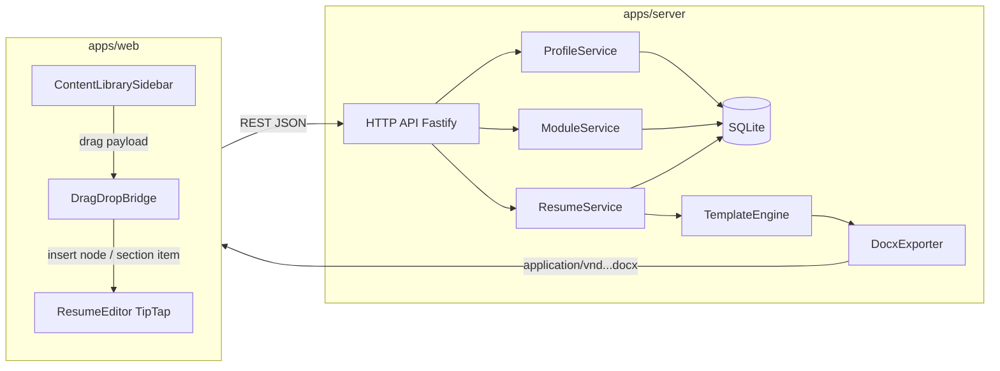
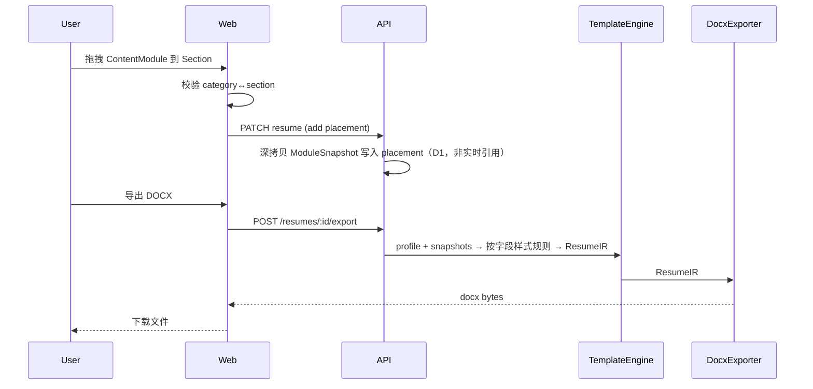
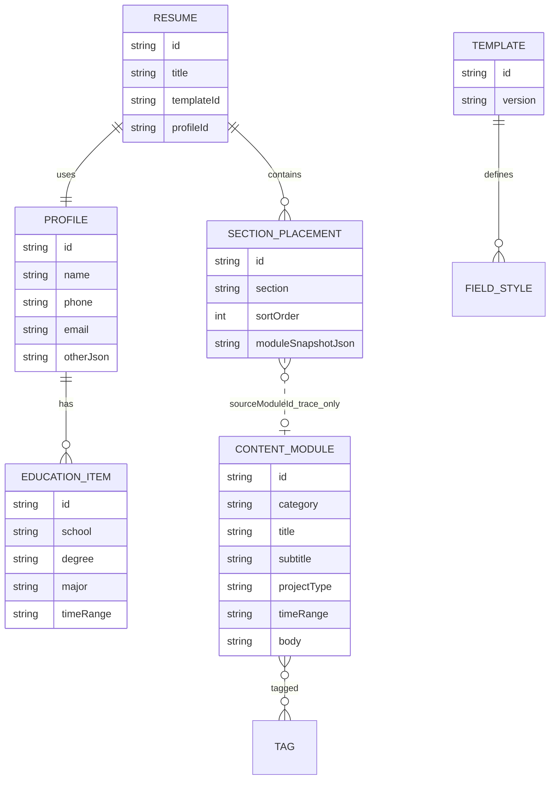

# 架构说明

- as_of: 2026-09-23
- status: Designed
- 关联: [01-requirements.md](./01-requirements.md) · [ADR](./adr/) · [contracts](./contracts/)

## 1. 系统形态

**近端原型**（D3）：本地 Web MVP。

- 浏览器 SPA（工作台：内容库侧栏 + 简历编辑主区）
- 本机 HTTP API（领域服务 + SQLite 文件）
- 导出在服务端生成 DOCX 字节流，浏览器下载

**长期**：同一领域模型 + SQLite schema 迁入 Win/Mac 可安装桌面壳（首选 Tauri，见 [ADR-0004](./adr/0004-desktop-path.md)）。



## 2. 核心流水线



**原则**：

- 编辑器负责交互与预览结构；**分字段排版语义**由 TemplateEngine 拥有；**DOCX** 只消费 ResumeIR。
- 模块 `body` 为纯文本；title/subtitle/projectType/timeRange/tags 等与 body **分字段存储**（D2）。
- 检索无 JD 实体，靠用户标签过滤（D4）。

## 3. 逻辑模块边界

| 模块 | 职责 | 不负责 |
|---|---|---|
| `profile` | 基本信息与教育 CRUD | 模块库、导出 |
| `content-library` | 模块存储、**标签 CRUD**、按标签/大类检索 | 版式、拖拽 UX、JD 实体 |
| `resume-assembly` | 简历草稿、拖入时 **SNAPSHOT** placements、顺序 | 具体像素排版、库→简历自动同步 |
| `template-engine` | **分字段**映射（title/time/body…）→ ResumeIR | 持久化、HTTP |
| `editor-shell` | TipTap 文档壳、section 节点、DnD 落点 | DOCX 二进制细节 |
| `export-docx` | ResumeIR → docx AST → Buffer | 业务校验以外的领域规则 |
| `shared/domain` | 类型、ID、兼容矩阵、错误码 | IO |

依赖方向（禁止反向）：

```text
editor-shell → resume-assembly / content-library (API)
export-docx → template-engine (types/IR)
apps/server → domain
apps/web → domain (类型) ；不得直接依赖 better-sqlite3
```

## 4. 数据模型（逻辑）



MVP 物理存储：单文件 SQLite，经 Node 内置 `node:sqlite`（路径可配置，默认 `./data/resume.db`）。桌面阶段仅改存放目录，**不改** Profile / ContentModule / ModuleSnapshot 概念（ADR-0004）。

`SECTION_PLACEMENT.moduleSnapshotJson` 存完整字段副本；`sourceModuleId` 仅溯源，库内更新不级联改简历。

## 5. 技术栈（结论）

详见 [adr/0001-stack.md](./adr/0001-stack.md)、[0002-editor.md](./adr/0002-editor.md)、[0003-export-docx.md](./adr/0003-export-docx.md)、[0004-desktop-path.md](./adr/0004-desktop-path.md)。

**一句话**：TypeScript monorepo（npm workspaces）+ Vite/React + TipTap + Fastify + SQLite + `docx`；近端本地 Web，长期 Tauri 桌面。

## 6. 仓库布局

```text
apps/web          # SPA：工作台、TipTap、DnD 壳
apps/server       # Fastify API、SQLite、导出
packages/domain   # 领域类型、兼容矩阵、IR 类型
packages/shared   # 跨包工具、结果类型、常量
docs/             # 需求/架构/ADR/合同/路线图
```

后续若模板或导出变复杂，可再拆 `packages/template-engine`、`packages/export-docx`；MVP 地基阶段逻辑放在 `apps/server/src/modules/*`，类型放 `packages/domain`。

## 7. 质量与证据（地基约束）

- 每个垂直切片必须有可观察用户结果 + 合同级测试（见 roadmap）。
- Mock 证据不得称为「真实导出已通」。
- 首个端到端切片建议：`创建模块 → 写入简历 placement → 导出非空 docx`（可暂用简化编辑器）。
