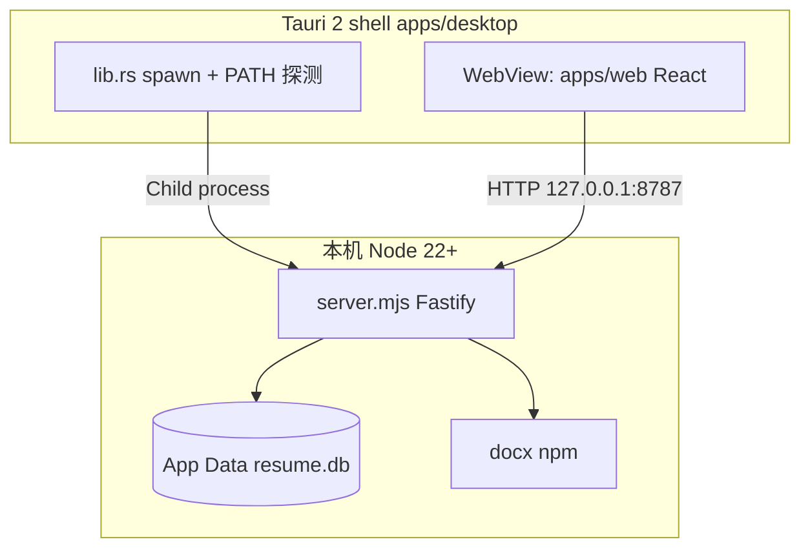
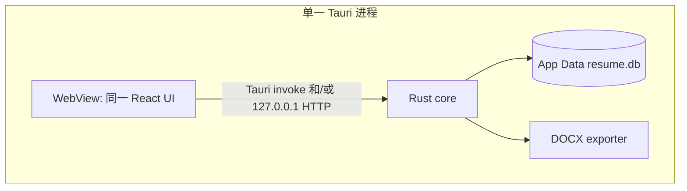

# Plan C：桌面核心迁入 Rust（消除终端用户 Node 依赖）

- as_of: 2026-09-23
- status: Accepted（决策见 [ADR-0006](./adr/0006-rust-core.md)）
- product: 拼履
- baseline snapshot: **`snapshot/pre-rust-node-sidecar`** @ `a9fc8f0422bc4f05646f3feabf2e19d97889f24d`
- branch pointer: `snapshot/pre-rust-baseline`（同 commit）

## 1. 目标

| 项 | 说明 |
|---|---|
| **用户体验** | Win/Mac 安装包**不要求**安装 Node；双击即用 |
| **进程模型** | 单个 Tauri 进程拥有 SQLite + 模板引擎 + DOCX 导出 + API |
| **数据安全** | App Data 下 `resume.db` / `photos/` 在更新与迁移中**不得被清空或覆盖** |
| **热更新** | 继续 GitHub Releases + `latest.json`（[ADR-0005](./adr/0005-desktop-updater.md)） |
| **对照** | 以 snapshot 标签做功能逐项 parity（UI / CRUD / 导出 / updater） |

非目标（第一里程碑）：不重写 TipTap、不做 PDF/JD/云同步、不捆绑开发者 `data/`。

---

## 2. 现状 vs 目标架构

### 2.1 现状（snapshot 冻结点）



要点：

- UI：`apps/web`（相对路径 `fetch('/api/...')`，由同机 HTTP 服务）
- API：`apps/server` 路由见 `routes/api.ts`（profile / modules / resumes / placements / export / photo / templates / meta）
- DB：`node:sqlite`，schema 见 `db/client.ts`；桌面注入 `RESUME_DB_PATH` → OS App Data
- 导出：Profile + placements → ResumeIR（template）→ `docx` Buffer
- 打包：`web-dist` + `server/server.mjs` + `templates/`；**禁止**打包 `data/`

### 2.2 目标（Plan C）



推荐默认路径：

1. **Phase 早期**：Rust 内嵌 HTTP（axum / tiny-http）监听 `127.0.0.1`，路径与 JSON **尽量与现 REST 一致** → 前端几乎零改，便于对照 snapshot。
2. **Phase 后期（可选）**：逐步迁到 Tauri commands；或保留 localhost API（调试友好）。两者可并存，但以一个为主路径。

---

## 3. 保留 / 迁移 / 删除

### 3.1 保持不变

| 资产 | 说明 |
|---|---|
| React UI | `apps/web` 工作台、四标签库、画布、DnD、表单 |
| Domain 合同 | `packages/domain`、`docs/contracts/*`（Snapshot-on-drop、兼容矩阵） |
| 模板包 | `templates/`（含 blue-black-simple / lin-v1 规则） |
| DB 路径约定 | 开发：`./data/resume.db`；桌面：App Data `com.pinlu.desktop/resume.db` + `photos/` |
| Updater | ADR-0005 签名与 `latest.json` |
| 分发隔离 | 永不打包开发机 DB / photos |

### 3.2 迁入 Rust

| 模块 | 现状 | Rust 目标 |
|---|---|---|
| HTTP/API | Fastify `routes/api.ts` | axum/tiny-http **或** `#[tauri::command]` 一一映射 |
| Store/SQLite | `db/store.ts` + `node:sqlite` | `rusqlite`（或 `sqlx` + sqlite）；**同 schema + 加法 ALTER** |
| Profile / Module / Resume | `modules/*` | Rust services；校验规则对齐 domain |
| Template → IR | `modules/template` | Rust 读模板定义 → ResumeIR JSON/结构体 |
| Photo | `/api/profiles/:id/photo` + 磁盘文件 | 同目录约定；multipart 或 base64/command 上传 |
| Export DOCX | npm `docx` | 见 §5 导出策略 |
| Health / meta | `/health`、`/api/meta` | 同契约，便于探针与对照 |

### 3.3 最终删除（在验收通过后）

- Tauri `spawn_local_server` / `find_node` / 对用户提示「请安装 Node」
- 安装包内 `desktop-resources/server/`
- 终端用户对 Node 22+ 的运行时依赖（**构建机**编前端仍可用 Node）

`apps/server` 可在过渡期保留为对照实现与 `npm test`；完全切齐后再标为 legacy 或仅 CI 对照。

---

## 4. 分阶段切片（垂直，带验收标准）

每阶段结束应能对照 snapshot **跑通对应用户路径**，并保留用户 DB。

### Phase 0 — Snapshot + 脚手架文档（本任务）

- [x] Annotated tag `snapshot/pre-rust-node-sidecar`
- [x] 分支指针 `snapshot/pre-rust-baseline`
- [x] ADR-0006 + 本文档；更新 ADR-0004 后果
- **验收**：文档可指导后续实现；可用 §7 命令检出对照基线

### Phase 1 — Rust 只读骨架（并行于 Node sidecar）

- 在 `apps/desktop/src-tauri` 增加 `core/`（或 `crate`）：打开 App Data DB（只读）、实现 `GET /health`、`GET /api/meta`、`GET /api/profiles`、`GET /api/modules`、`GET /api/resumes/:id`（嵌入 HTTP **不同端口** 或 feature flag）
- **不**移除 Node spawn
- **验收**：
  - 同一用户 DB 下，Rust 只读结果与 Node JSON **字段级一致**（可用脚本 diff）
  - 打开现有 App Data 库不报错、不写坏 schema

### Phase 2 — CRUD 写入迁 Rust（feature flag）

- 实现 profiles / modules / resumes / placements / photo 的写路径；错误码与 4xx 形状对齐
- 桌面用环境变量或编译 feature 在「Node API」与「Rust API」间切换
- **验收**：
  - 对空库跑完 [05-acceptance.md](./05-acceptance.md) 主路径（建卡、CRUD、拖入）数据落在同一 `resume.db`
  - 重启后数据仍在；与 snapshot 行为一致（含 snapshot-on-drop：改库不改已落简历）

### Phase 3 — 模板渲染 + 导出 parity

- ResumeIR 生成与 DOCX 字节对齐（见 §5）
- 照片 fitContain、页眉居中、蓝黑简洁版式
- **验收**：
  - 同一输入 fixture：IR 快照测试通过
  - 导出 DOCX 可在 Word/WPS 打开；与 snapshot 导出 **视觉/结构对照清单**（§6）打勾
  - 「另存为」路径仍经系统对话框（若现状如此则保持）

### Phase 4 — 移除 Node sidecar

- 默认仅 Rust API；删除 spawn / Node 探测 / bundle server.mjs
- 更新 README / 安装说明：**无需 Node**
- **验收**：干净机器（无 Node）安装包可完成验收清单；有 Node 的机器行为不变

### Phase 5 — 打包与 CI

- `desktop-release.yml`：构建产物不含 server 资源；updater 仍上传 `latest.json`
- Mac + Win 安装包冒烟
- **验收**：tag `v*` 流水线绿；已装旧版（Node sidecar）用户可热更到无 Node 版且 **DB 保留**

---

## 5. DOCX 导出策略（分阶段决策）

现状强依赖 npm **`docx`**（段落、Tab、ImageRun、中文间距细节多）。

| 选项 | 何时采用 |
|---|---|
| **A. 纯 Rust**（如 `docx-rs` 或手写 OOXML） | 默认目标；Phase 3 先做 IR→DOCX 最小版式，再补照片/蓝黑细节 |
| **B. 过渡：内嵌极小 JS 仅导出** | 仅当 A 在 Phase 3 内无法达到 §6 导出 fidelity；**不**要求用户装 Node——可用 deno_core / 预编译单文件 worker / 构建期生成，由 Rust 调 |
| **禁止** | Playwright HTML→DOCX；捆绑完整 Node 发行版「只为导出」 |

决策记录：Phase 3 结束时在本文档追加「选用 A 或 B + 理由」一行即可，必要时补短 ADR。

---

## 6. Parity 对照清单（相对 snapshot）

开发时一边跑 snapshot 基线，一边跑 Rust 分支，逐项勾选：

| # | 能力 | 对照要点 |
|---|---|---|
| 1 | 内容库四标签 | 项目 / 实习 / 获奖与证书 / 基本信息 |
| 2 | 模块 CRUD | 新建、编辑、删除、标签过滤 |
| 3 | 拖入快照 | drop 时深拷贝；改库不改简历内条目 |
| 4 | 基本信息卡 | 必填校验；应用到简历；教育日期（含「至今」） |
| 5 | 获奖级别等字段 | 表单字段与导出/画布展示一致 |
| 6 | 证件照 | 上传/删除；画布与 DOCX 居中页眉；小于 5MB |
| 7 | 画布滚动 | 左右面板滚动不互相吞事件 |
| 8 | 导出 DOCX | 另存为；蓝黑简洁；有照片则嵌入且不拉伸变形 |
| 9 | 持久化 | App Data DB；热更新后数据仍在 |
| 10 | Updater | `latest.json` 检查 → 下载安装 → 重启 |
| 11 | 安装包 | macOS DMG/app + Windows NSIS；干净机无 Node 可跑（Phase 4+） |

自动化：保留并迁移关键 `apps/server` 合同测试意图到 Rust（或双跑 diff）；`npm test` 在过渡期继续绿。

---

## 7. 如何使用 Snapshot 做对照 / 调试

### 7.1 检出基线（只读对照）

```bash
# 查看标签
git show snapshot/pre-rust-node-sidecar --no-patch

# 临时检出（detached HEAD）——勿在此提交 Plan C 实现
git checkout snapshot/pre-rust-node-sidecar

# 或建本地对照 worktree（推荐，不打断 main）
git worktree add ../resume_system_pre_rust snapshot/pre-rust-node-sidecar
```

### 7.2 跑旧架构

```bash
# 浏览器验收（开发库 ./data/resume.db —— 勿指向用户正式库做破坏性试验）
npm install && npm run app
# 打开 http://127.0.0.1:8787/ ，按 docs/05-acceptance.md

# 或桌面壳（仍会 spawn Node）
npm run app:desktop
```

**注意**：对照时使用**副本** DB（复制 App Data `resume.db` + `photos/`），避免误伤正式数据。

### 7.3 对照手法

1. 同一操作序列在 snapshot 与 Plan C 分支各做一遍  
2. 导出两个 DOCX，并排打开看版式  
3. 对关键 API：`curl` / 脚本比较 JSON（忽略 `updated_at` 等易变字段）  
4. Bug 时先确认「基线是否也有」——避免把旧缺陷当回归

### 7.4 推送标签（若本地尚未推送）

```bash
git push origin refs/tags/snapshot/pre-rust-node-sidecar
git push origin snapshot/pre-rust-baseline
```

---

## 8. 风险与缓解

| 风险 | 缓解 |
|---|---|
| Schema 迁移写坏库 | 只做加法 `ALTER`；启动前可备份 `resume.db`；测试用副本 |
| DOCX fidelity 差距 | Phase 3 强制视觉对照；必要时短暂采用 §5 选项 B |
| 前端假设 HTTP | 先嵌 HTTP 保合同，再考虑 commands |
| Win/Mac 路径差异 | 统一经 Tauri `app_data_dir()`；照片相对 DB 目录 |
| 热更新跨 Node→Rust | 确认资源清单变化；用户 DB 路径不变即可保数据 |
| 双边维护成本 | 用 feature flag 尽快切默认；过时后删 Node spawn |

---

## 9. 第一里程碑非目标

- 不重写 TipTap / 不改主交互隐喻  
- 不做多模板设计器、PDF、JD、云同步  
- 不把 Plan C 与无关 UI 大改并行  
- 不在本计划内「优化」已验收的 React 视觉，除非 parity 需要  

---

## 10. 建议实现入口（轻量，非本任务必做）

- `apps/desktop/src-tauri/src/lib.rs`：后续以 `mod core;` 接入；Phase 4 删除 spawn  
- 新目录建议：`apps/desktop/src-tauri/src/core/{db,api,export,template}.rs`  
- 开发开关例：`RESUME_API=rust|node`（默认 Phase 1–2 为 `node`）  

详见 `apps/desktop/README.md` TODO。
