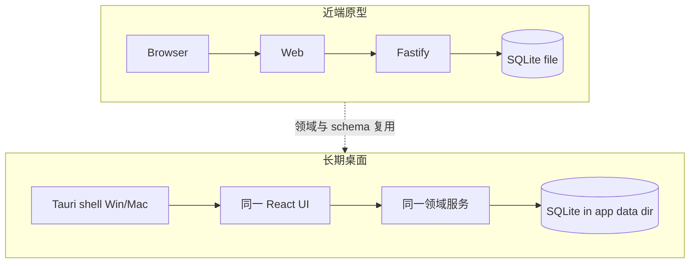

# ADR-0004：原型本地 Web → 长期桌面分发

- status: Accepted
- date: 2026-09-23
- relates: D3；[ADR-0001](./0001-stack.md)

## 背景

长期目标：可安装的 **Windows + Mac** 桌面应用，分发给他人机器，数据本地持久化。  
近期目标：最快跑通原型，验证模块库 / 快照组装 / 模板 / DOCX。

## 决策

### 近端（Prototype）

保持当前脚手架：

- `apps/web`（Vite + React）+ `apps/server`（Fastify）+ **SQLite 文件**
- 本机浏览器访问；数据落在可配置的 SQLite 路径（如 `./data/resume.db`）

### 远端（Product packaging）

迁入 **桌面壳**，首选 **Tauri 2**：

| 选项 | 结论 |
|---|---|
| **Tauri（首选）** | 体积小、系统 WebView、Rust 侧易托管本地进程/sidecar 或直接调命令；适合「本地工具 + SQLite」 |
| Electron | 可行、生态熟，但包体与内存更重；仅当 Tauri 插件/打包阻塞时再评估 |

### 迁移原则（避免重写领域）

1. **`@resume/domain` 与合同类型不变**；桌面壳不重新发明 Profile/Module/Snapshot。
2. **持久化继续 SQLite**（或同一 schema 的嵌入式库）：原型阶段路径在开发目录；桌面阶段改为应用数据目录，**迁移脚本只搬家/升 schema，不改概念模型**。
3. API 边界保留：桌面内可嵌本地 HTTP（现状）或逐步改为 Tauri commands；**服务层模块**（profile / content-library / resume / template / export）应与传输层可拆。
4. 导出仍走 ResumeIR → `docx`；桌面仅多一层「存文件到用户选取路径」。

## 后果

- S1–S4 **原型**可在浏览器双终端或 `npm run app` / Tauri 壳下验收。
- 首版桌面壳仍依赖本机 **Node 22+** 启动内置 API（`server.mjs` sidecar）；真正无 Node 的单文件安装包另开切片。
- 安装包资源：`web-dist` + `server/server.mjs` + `templates/`；**禁止**打包 `data/` / `*.db` / `photos/`。
- CI：`.github/workflows/desktop-release.yml` 在 tag `v*` 时构建 macOS + Windows 并上传 Release。
- 禁止把权威数据只放在浏览器 IndexedDB 而无法导出到文件型 SQLite（与迁移原则冲突）。
- SQLite：开发 `./data/resume.db`（**gitignored**，首次启动自动创建，无需用户配置）；Tauri 使用系统 **app data** 目录下自动建库。
- **分发隔离**：安装包只带 `web-dist` UI；**禁止**把开发机 `data/`、`*.db`、`photos/` 打进 bundle。每位用户的数据只存在本机。

## 非目标（本 ADR）

- 云同步、多设备账号
- 纯浏览器 PWA 作为最终交付形态
